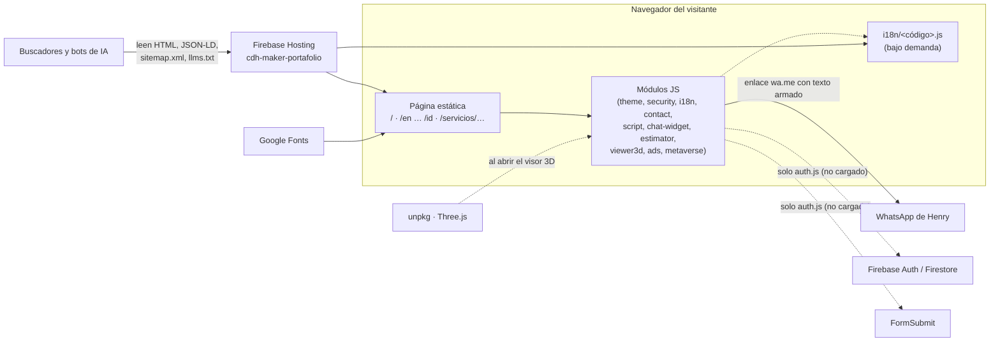
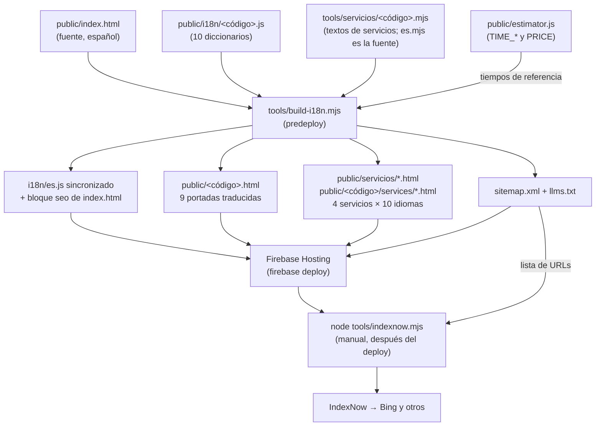
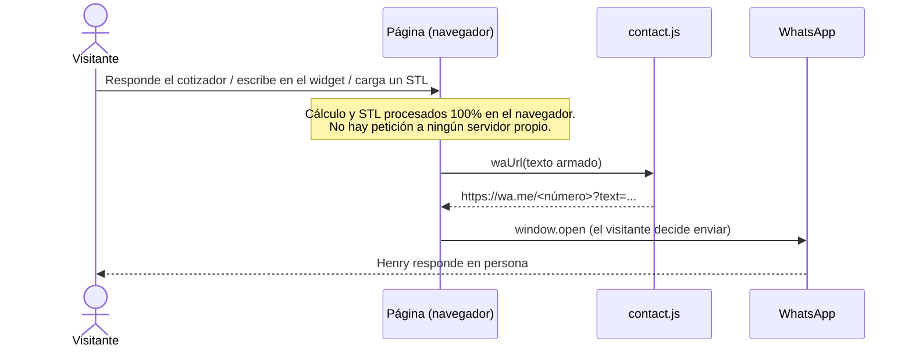
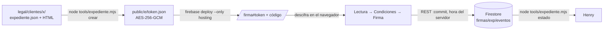

# Arquitectura — Portafolio CDH Maker

Mapa para quien llega nuevo al repo: qué piezas hay, cómo se conectan y por qué están así.
El detalle operativo (claves de `localStorage`, cómo editar traducciones, guías de mantenimiento)
vive en [MANUAL-TECNICO.md](MANUAL-TECNICO.md); aquí se resume y se enlaza con `§`.

> Estado verificado contra el código el 2026-10-25 (último commit `ee4aa6a`). Donde el README
> o el manual describen algo que ya no está, se indica en [Desfases detectados](#9-desfases-detectados).

---

## 1. Visión general

- **Sitio estático**: HTML + CSS + JavaScript puro, sin framework ni bundler. Lo único que se
  "construye" es HTML (páginas por idioma y por servicio) con un script de Node sin dependencias.
- **Hosting**: Firebase Hosting, proyecto `cdh-maker-portafolio` (`.firebaserc`), carpeta
  `public/`, `cleanUrls: true`. Dominio canónico `https://cdhmaker.com`; también responde en
  `cdh-maker-portafolio.web.app`.
- **Sin backend propio**. Todo corre en el navegador del visitante. Los servicios externos son:

| Servicio | Para qué | Cuándo se usa |
|---|---|---|
| **WhatsApp** (`wa.me`) | Canal único de contacto y cotización | Al pulsar enviar en el widget, el cotizador o el visor 3D |
| **Google Fonts** | Space Grotesk + Inter | En cada página (y en los documentos de `legal/`) |
| **unpkg** (Three.js 0.128.0) | Render del visor STL | Solo la primera vez que se abre el visor 3D |
| **IndexNow** (`api.indexnow.org`) | Avisar a Bing de las URLs cambiadas | A mano, después de cada deploy |
| **Firebase Auth + Firestore** | Cuentas y CRM en la nube | Código **latente**: `auth.js` existe pero ninguna página lo carga (ver §9) |
| **FormSubmit** | Correo a CDH Maker por cada registro | Igual que el anterior: solo desde `auth.js`, hoy sin uso |



## 2. Build y despliegue

`firebase deploy --only hosting` ejecuta primero `node tools/build-i18n.mjs` (`hosting.predeploy`
en `firebase.json`). Ese script toma `public/index.html` (fuente en español) y los diccionarios, y
escribe todo lo que se publica generado. Detalle en MANUAL §8.3, §8.4 y §11.



- Los archivos generados **se versionan**: tras editar `index.html` o un diccionario, correr el
  build y hacer commit de lo generado, para que el repo refleje lo publicado.
- `--strict` hace fallar el build si falta alguna traducción (sin él solo avisa y usa el español).
- `tools/`, `legal/` y `_originales-media/` están fuera de `public/`: **no se publican**.
- Caché: HTML `no-cache`, CSS/JS 1 hora, medios 7 días. Al editar un `.js`/`.css` hay que subir
  su `?v=` en las etiquetas; los diccionarios se versionan con `DICT_V` en `i18n.js` (MANUAL §10).

## 3. Mapa de módulos del front (`public/`)

Orden real de carga en `index.html` (las páginas de servicio cargan los mismos, con ruta absoluta
`/archivo.js`). Todos son IIFE autocontenidas que se comunican por globales `window.CDH_*` y
eventos `cdh:*`.

| Archivo | Qué hace | Carga | Depende de / publica |
|---|---|---|---|
| `theme.js` | Tema claro/oscuro antes del primer pintado; `?theme=` lo fuerza | `<head>`, inmediato | Emite `cdh:themechange` |
| `security.js` | Capa disuasoria anti-inspección/copia (se apaga en localhost) | `<head>`, inmediato | Publica `CDH_SECURITY` |
| `metaverse.js` | Fondo animado en canvas 2D, seis capas; respeta *reducir movimiento* y pausa con la pestaña oculta | Final del `<body>` | Escucha `cdh:themechange` |
| `i18n.js` | El idioma lo decide la URL; selector, migración de `?lang=`, aviso de idioma sugerido sin redirigir | Final del `<body>` | Descarga `i18n/<código>.js` **bajo demanda** (el español no descarga nada); publica `CDH_I18N`, `CDH_TYPED`; emite `cdh:langchange` |
| `contact.js` | Arma los enlaces de WhatsApp y correo (datos ofuscados con desplazamiento, contra bots de spam) para cualquier visitante | Final del `<body>` | Publica `CDH_CONTACT.waUrl/mailUrl` |
| `script.js` | Menú, scroll, apariciones, contadores, texto rotativo, FAQ, efectos | Final del `<body>` | Lee `CDH_TYPED`; escucha `cdh:langchange` |
| `chat-widget.js` | Cajita "Escríbeme directo": el mensaje se abre en el WhatsApp del visitante | Final del `<body>` | `CDH_CONTACT`; `cdh:langchange` |
| `estimator.js` | Cotizador instantáneo: preguntas → rango de tiempos (y costo de material en fabricación) calculado en el navegador | Final del `<body>`; el modal se abre a pedido | `CDH_CONTACT`; publica `CDH_ESTIMATOR`; sus constantes alimentan el build |
| `viewer3d.js` | Visor STL local (nada se sube); medidas y paso al cotizador | Final del `<body>`; **Three.js desde unpkg al abrirlo** | `CDH_CONTACT`, `CDH_ESTIMATOR`; publica `CDH_VIEWER3D` |
| `ads.js` | Cinta `#cinta` tras el hero: Shorts del canal (`media/shorts.json`, de `tools/sync-shorts.mjs`) + ofertas (servicios, "Vende en YAM" y feed `yam.cdhmaker.com/api/publico/vitrina` con respaldo fijo) | Final del `<body>`; datos al terminar la carga; iframe de youtube-nocookie solo al abrir un Short | `CDH_CONTACT` (WhatsApp) |
| `auth.js` | Registro/login, vault local PBKDF2, CRM, Firestore, FormSubmit, SDK de Firebase diferido | **No se carga en ninguna página** | Publicaría `CDH_AUTH` |
| `voice.js` | Síntesis de voz (Web Speech API) para el antiguo asesor | **No se carga en ninguna página** | Publicaría `CDH_VOICE` |

Otras páginas: `perfil.html` (lee una sesión de `localStorage` que solo crearía `auth.js`),
`admin-clientes.html` (CRM local con clave), `404.html`. Solo cargan `theme.js` más su script
en línea.

## 4. Flujo de datos de un visitante

Desde `e17eda4` el portafolio es **público y sin cuenta**: no hay registro en el sitio publicado.
El visitante contacta o cotiza y **todo sale por WhatsApp, iniciado por él**:



- **Qué datos**: el texto que escribe el visitante o el resumen del cotizador (servicio y
  respuestas). Del visor 3D solo las medidas, si decide pasarlas al cotizador; el archivo STL
  nunca sale del equipo.
- **Adónde van**: únicamente a WhatsApp, en la conversación que abre el propio visitante. El
  sitio no guarda ni envía nada por su cuenta.
- **En el navegador** solo quedan preferencias: tema e idioma elegido (la cinta de la portada no guarda nada).
- **Flujo latente (auth.js)**: si se reactivara, un registro guardaría nombre, email, teléfono,
  empresa e interés en el CRM local, en Firestore (`clients/{uid}`) y enviaría un correo vía
  FormSubmit. Descrito en MANUAL §4.3; hoy no ocurre.

## 5. i18n y SEO

- **10 idiomas**: es, en, zh, hi, ar (RTL), pt, bn, ru, fr, id. Lista única en `LANGS` de
  `tools/build-i18n.mjs`.
- **Rutas**: español en `/`; los demás en `/<código>` (servido desde `public/<código>.html` con
  `cleanUrls`). `/<código>/` redirige 301 a `/<código>`.
- **Servicios**: 4 × 10 = 40 páginas. Español en `/servicios/<slug>`, resto en
  `/<código>/services/<slug-en>` (tabla de slugs en MANUAL §8.4).
- **Cabecera generada** (bloque `seo:start … seo:end`, no se edita a mano): title, description,
  canonical, 11 `hreflang` (10 + `x-default`), Open Graph y Twitter.
- **JSON-LD**: portada con `ProfessionalService`/`Organization`, `Person` (fundador), `OfferCatalog`,
  `ItemList` de proyectos y `FAQPage`, en el idioma de cada página; servicios con `Service`
  (`provider` = `#org`), `BreadcrumbList`, `FAQPage` y `WebPage`.
- **Rastreo**: `robots.txt` permite y nombra los bots de IA y excluye `/perfil` y
  `/admin-clientes`; `sitemap.xml` con alternates; `llms.txt` como resumen para modelos;
  IndexNow con la clave publicada en `public/<32 hex>.txt`.
- El texto real (cifras, FAQ) está en el HTML sin depender de JavaScript, porque los bots de IA
  casi nunca lo ejecutan. Más en MANUAL §8 y en `PLAN-VISIBILIDAD-IA.md`.

## 6. Seguridad

| Capa | Dónde | Qué aporta |
|---|---|---|
| Cabeceras HTTP | `firebase.json` | `X-Content-Type-Options: nosniff`, `X-Frame-Options: SAMEORIGIN`, `Referrer-Policy: strict-origin-when-cross-origin`, `Permissions-Policy` sin cámara/micrófono/geolocalización. Se declaran **también para las rutas limpias** (`/`, `/<código>`, `/servicios/**`, `/<código>/services/**`, `/perfil`, `/admin-clientes`) porque con `cleanUrls` las reglas `**/*.html` no se aplicaban (`6445601`). El panel admin lleva además `no-store` y `X-Robots-Tag: noindex, nofollow`. No hay CSP. |
| Reglas de Firestore | `firestore.rules` | Colección `clients`: crear exige sesión y `email`/`name` de tipo texto; leer/actualizar solo el dueño (uid o email del token); borrar nadie desde el cliente. Es la capa real si se reactiva `auth.js`. |
| `security.js` | Navegador | **Disuasoria**: bloquea clic derecho, atajos de DevTools y copia, difumina si detecta DevTools, silencia `console`. Se desactiva en localhost y con un parámetro de URL documentado en MANUAL §7.1. No protege nada que el código fuente público no exponga ya. |
| Panel admin | `admin-clientes.html` | La clave nunca está en el código: se compara su hash SHA-256 (WebCrypto). Cambiarla: MANUAL §6. Ojo: el hash está en un repo público, así que la fortaleza depende de que la clave sea larga y no adivinable. |
| Contacto ofuscado | `contact.js` | Número y correo no están en texto plano en el fuente (anti-recolección por bots). |
| Config de Firebase | `auth.js` | La `apiKey` del cliente es pública por diseño de Firebase; la protección la dan las reglas. |

## 7. Documentos legales (`legal/`)

Documentos comerciales y legales en HTML, pensados para imprimir en A4 o exportar a PDF. Fuera de
`public/`: no se publican en el sitio.

```
legal/
├── _base/documento.css   # Hoja común A4 (tipografía, tinta navy, acento cian, campos .campo)
├── sitio/                # Documentos del sitio web (versionados)
├── servicios/            # Documentos por servicio (versionados)
├── productos/            # Documentos por producto (versionados)
└── clientes/             # Documentos firmados o por firmar: EXCLUIDA de git
```

- **Convención**: cada documento es un `.html` autónomo que enlaza la hoja común con ruta
  relativa (por ejemplo `../../_base/documento.css` desde `clientes/<cliente>/`). Las carpetas
  que empiezan por `_` son recursos, no documentos.
- **`legal/clientes/` está en `.gitignore`**: el repo es público y esos documentos llevan montos,
  NIT y datos personales. Solo viven en el disco (y en OneDrive). No moverlos a otra carpeta
  versionada.
- **PDF**: `node tools/legal-pdf.mjs [carpeta]`, desde la raíz del repo. Recorre la carpeta
  (por defecto `legal/`, saltando las que empiezan por `_`) y, con Microsoft Edge sin interfaz
  (`--headless=new --print-to-pdf`), deja cada PDF junto a su HTML con el mismo nombre. Requiere
  Edge instalado en Windows.
- **`legal/portal/`**: acuerdo de uso de firma electrónica y aviso de privacidad del portal de
  firma (versionados; se incluyen en cada expediente).

### 7.1 Portal de firma electrónica (`/firma`)

El cliente recibe un enlace `https://cdhmaker.com/firma#<token>` y, **por otro canal**, un código
de 8 caracteres. Lee la carta y el video, lee y acepta el contrato, el acuerdo de firma electrónica
y el aviso de privacidad, y solo entonces puede firmar el acta y el plan de pago. Descarga cada
documento en PDF con su constancia de firma.



- **Sin datos del cliente en el repo**: `public/e/` está en `.gitignore`, pero se publica con el
  deploy. El paquete va cifrado (clave PBKDF2-SHA256, 600 000 iteraciones, de código + token);
  sin el código no se lee. El token va en el `#` y nunca llega a los registros del servidor.
- **Firestore como registro de prueba**: `firmas/{SHA-256(token:código)}/eventos/{id}`, con id
  `lectura-<doc>`, `condiciones` o `firma-<doc>`. `firestore.rules` exige el orden (no se firma
  sin condiciones aceptadas y sin el documento leído), fija `at = request.time` y prohíbe editar
  o borrar. Cada evento guarda la huella SHA-256 del documento que vio el firmante.
- **Los ids de las condiciones** (`contrato`, `firmaelec`, `privacidad`) están en tres sitios que
  deben coincidir: `firma.js` (REQUERIDOS), `tools/expediente.mjs` y `firestore.rules`.
- **No recrear un expediente con cambios después de enviado**: la huella cambia. Para corregir,
  `crear … --nuevo-codigo` (expediente nuevo, firmas desde cero).
- **Deploy desde otro equipo**: `public/e/` no viaja en git; un deploy desde un clon limpio borra
  los paquetes publicados. Desplegar siempre desde el equipo que tiene `legal/clientes/`.
- **Prueba local**: `http://localhost:5055/firma?local#<token>` guarda los eventos en
  `localStorage` en vez de Firestore.

### 7.2 CRM y firma con enlaces temporales (`/crm`, `/firmar`)

- **Acceso**: `cdhmaker.com/crm`, sin clave. El administrador escribe su correo y entra con el enlace que
  le llega (Firebase Auth, «vínculo de correo electrónico»). Administradores en dos sitios que deben
  coincidir: `ADMINS` de `public/crm/app.js` y `esAdmin()` de `firestore.rules`.
- **Datos** (Firestore de `cdh-maker-portafolio`, solo administradores): `crm_clientes/{id}` con datos y
  plan de cuotas; `solicitudes/` de firma; `archivos/{aid}/partes/{n}` con PDF y `registro.json` en base64
  (Cloud Storage exige el plan Blaze). Los enlaces de firma viven en `enlaces/{token}` y se firman en
  `/firmar#token`; el PDF firmado se arma en el navegador (`public/crm/ensamblar.js`).
- **Sistema anterior**: las solicitudes con `sistema: 'cdhmaker-firmas'` (proyecto `cdhmaker-firmas`,
  creadas con `App Balmer/firmas/crear.mjs`) se leen por token en modo solo lectura.
- **Importar**: `node tools/crm-expediente.mjs datos.json salida.json tipo=archivo.pdf …` arma un
  `.json` (esquema `cdhmaker.crm.importacion.v1`) que se carga en CRM → Importar. Guardarlo en
  `legal/clientes/`, nunca en `public/`.

## 8. Decisiones de arquitectura

Deducidas del historial (`git log`). Formato corto: contexto → decisión → consecuencia.

**ADR-1. Sitio estático en Firebase Hosting, sin backend** (`ff9f385`, `f6f41a4`)
- *Contexto*: portafolio de una persona, sin presupuesto de operación.
- *Decisión*: HTML/CSS/JS puros en Firebase Hosting; nada que mantener en servidor.
- *Consecuencia*: costo cero y deploy en un comando; toda lógica es visible en el navegador, así
  que no puede haber secretos en el front.

**ADR-2. Caché por tipo y versionado manual con `?v=`** (`142b196`)
- *Contexto*: visitantes con versiones viejas tras un deploy.
- *Decisión*: HTML `no-cache`; CSS/JS 1 h; medios 7 días; cada cambio de asset sube su `?v=`.
- *Consecuencia*: sin bundler que genere hashes; olvidar el `?v=` deja la versión vieja hasta 1 h.

**ADR-3. Firebase SDK bajo demanda** (`0604921`)
- *Contexto*: ~300 KB de SDK en cada visita, aunque casi nadie creaba cuenta.
- *Decisión*: `auth.js` descarga el SDK solo al abrir el área de clientes o si el navegador ya tuvo cuenta.
- *Consecuencia*: carga inicial más liviana. Quedó superada por ADR-6, pero el mismo patrón
  (cargar al primer uso) se repite en diccionarios, Three.js y el reproductor de los Shorts de la cinta.

**ADR-4. Un diccionario por idioma, cargado bajo demanda** (`95a6551`)
- *Contexto*: `i18n.js` pesaba 103 KB con los 10 idiomas dentro.
- *Decisión*: motor de ~9 KB y `public/i18n/<código>.js` aparte, versionados con `DICT_V`.
- *Consecuencia*: quien entra en español no descarga diccionarios; si una descarga falla, la
  página se queda en el idioma que ya muestra.

**ADR-5. Cabeceras también para rutas limpias** (`6445601`)
- *Contexto*: con `cleanUrls` el navegador pide `/perfil`, no `/perfil.html`, y las cabeceras de
  seguridad nunca llegaban.
- *Decisión*: duplicar las reglas para cada patrón de ruta limpia.
- *Consecuencia*: `firebase.json` es repetitivo; toda ruta nueva necesita su regla de cabeceras.

**ADR-6. Portafolio público, sin login** (`e17eda4`)
- *Contexto*: exigir cuenta para ver contacto y servicios frenaba a los clientes.
- *Decisión*: quitar el sistema de cuentas del sitio; `contact.js` (ligero) reemplaza a `auth.js`
  y el contacto queda a un clic, con la misma ofuscación anti-spam.
- *Consecuencia*: no se recogen datos de visitantes. `auth.js`, `perfil.html`,
  `admin-clientes.html` y `firestore.rules` quedaron en el repo sin uso efectivo (§9).

**ADR-7. Widget directo a WhatsApp en vez de chatbot de menús** (`24453e1`)
- *Contexto*: `chatbot.js` + `chatbot-kb.js` (233 KB de respuestas en 10 idiomas) simulaban una
  conversación con intenciones, memoria y voz.
- *Decisión*: `chat-widget.js`, una caja donde el visitante escribe y se abre su WhatsApp con el
  texto listo; Henry responde en persona.
- *Consecuencia*: mucho menos código y peso, y trato humano. Sin respuestas automáticas fuera de
  horario. `voice.js` quedó huérfano.

**ADR-8. Una página estática por idioma para buscadores e IA** (`6656470`)
- *Contexto*: los rastreadores de IA no ejecutan JavaScript; la traducción en el navegador era
  invisible para ellos.
- *Decisión*: `tools/build-i18n.mjs` genera una URL por idioma con metadatos, hreflang y JSON-LD,
  más `sitemap.xml` y `llms.txt`; corre como predeploy. El idioma lo decide la URL y nunca se
  redirige automáticamente.
- *Consecuencia*: hay HTML generado versionado que no se edita a mano; `index.html` es la fuente.

**ADR-9. Páginas por servicio y ciudad** (`ae02a83`)
- *Contexto*: búsquedas como "impresión 3D Medellín" premian una URL propia por servicio.
- *Decisión*: 4 servicios × 10 idiomas generados por el mismo build, con textos en
  `tools/servicios/` y tiempos tomados de `estimator.js`.
- *Consecuencia*: una sola fuente para los tiempos (cotizador y páginas no se contradicen);
  agregar un servicio toca el build, 10 archivos de textos y `index.html` (MANUAL §8.4).

**ADR-10. Superficies sólidas sobre el canvas** (`ee4aa6a`)
- *Contexto*: el vidrio desenfocado sobre el fondo animado costaba rendimiento.
- *Decisión*: superficies sólidas y resolución del canvas limitada a 1.5×.
- *Consecuencia*: mejor fluidez en equipos modestos, misma identidad visual.

## 9. Desfases detectados

Diferencias entre la documentación existente y el código a la fecha de este documento. No se
corrigieron aquí; quedan para una pasada de limpieza.

**README.md**
- La estructura lista `chatbot.js` y `chatbot-kb.js`: **ya no existen** (eliminados en `24453e1`,
  reemplazados por `chat-widget.js`). También describe el "Asesor Maker con memoria avanzada",
  que ya no existe.
- "Cuenta obligatoria para ver servicios y contacto" y la base de clientes con FormSubmit/CRM:
  **ya no aplica** desde `e17eda4`; el sitio es público y el contacto no exige cuenta.
- Describe `auth.js` como vigente; existe pero **no lo carga ninguna página**.
- La estructura omite `contact.js`, `chat-widget.js`, `estimator.js`, `viewer3d.js`, `ads.js`,
  `theme.js`, `voice.js`, `tools/` y `legal/`.

**MANUAL-TECNICO.md**
- §1 y §2: tabla y árbol citan `chatbot.js`, `chatbot-kb.js` y `auth.js` como activos; el fondo
  se describe como "construcción LEGO" (ya es el "núcleo tecnológico"); la raíz figura como
  `PORTAFOLIO HCT/`; "Sitio en producción" apunta a `web.app` aunque el canónico es `cdhmaker.com`.
- §3: el orden de carga incluye `auth.js` y `chatbot.js` y omite `contact.js`, `chat-widget.js`,
  `estimator.js` y `viewer3d.js`. La tabla de eventos cita `cdh:authchange` y oyentes que ya no
  se cargan.
- §4, §5 y §9 (con §9.1): describen el sistema de cuentas, el panel del cliente, el chatbot y su
  voz como si estuvieran en uso.
- §10: el ejemplo de versionado usa `auth.js?v=6`, archivo que ya no se enlaza.

**Código sin uso en `public/`** (se publica, pero nada lo carga ni lo enlaza)
- `auth.js` y `voice.js`: ninguna página los incluye.
- `perfil.html` y `admin-clientes.html`: dependen de datos en `localStorage` que solo escribía
  `auth.js`; ninguna página los enlaza (solo `robots.txt` los excluye). `admin-clientes.html`
  sigue siendo accesible por URL.
- `firestore.rules`: sigue desplegable, pero hoy nada escribe en Firestore.
